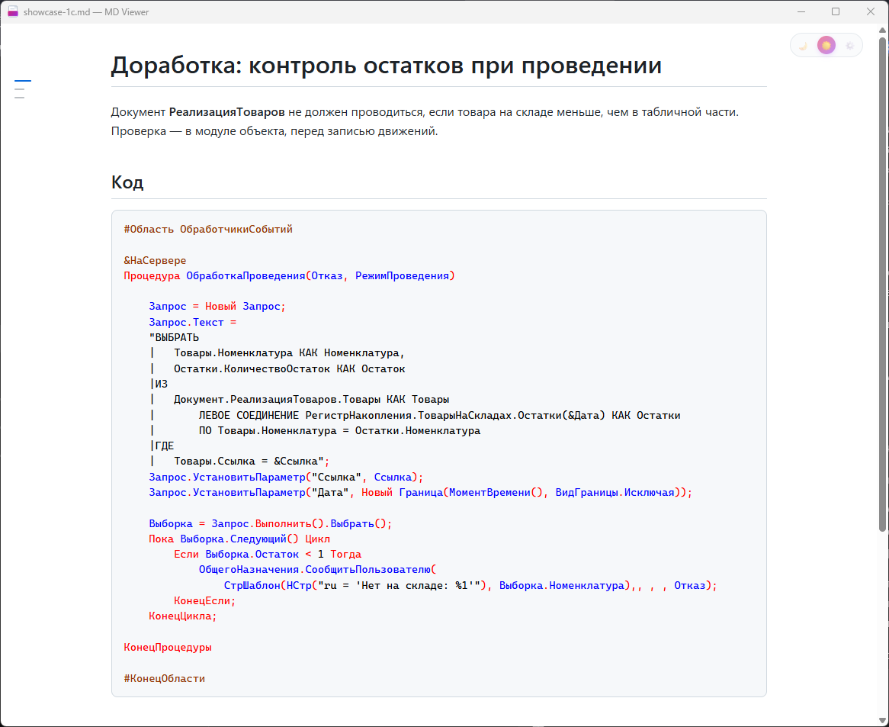
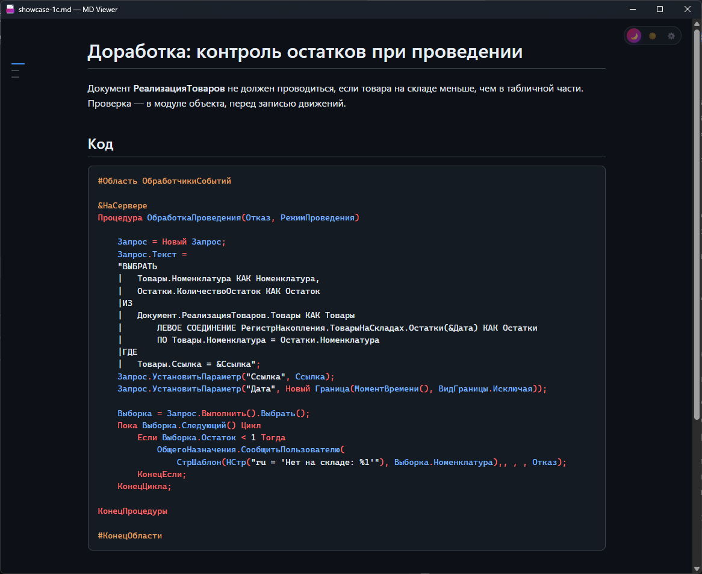
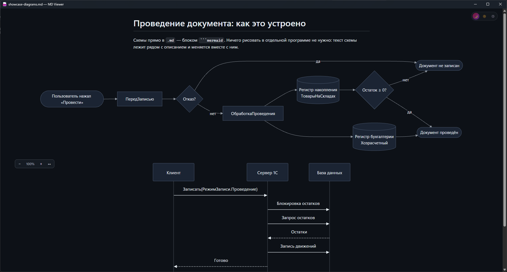
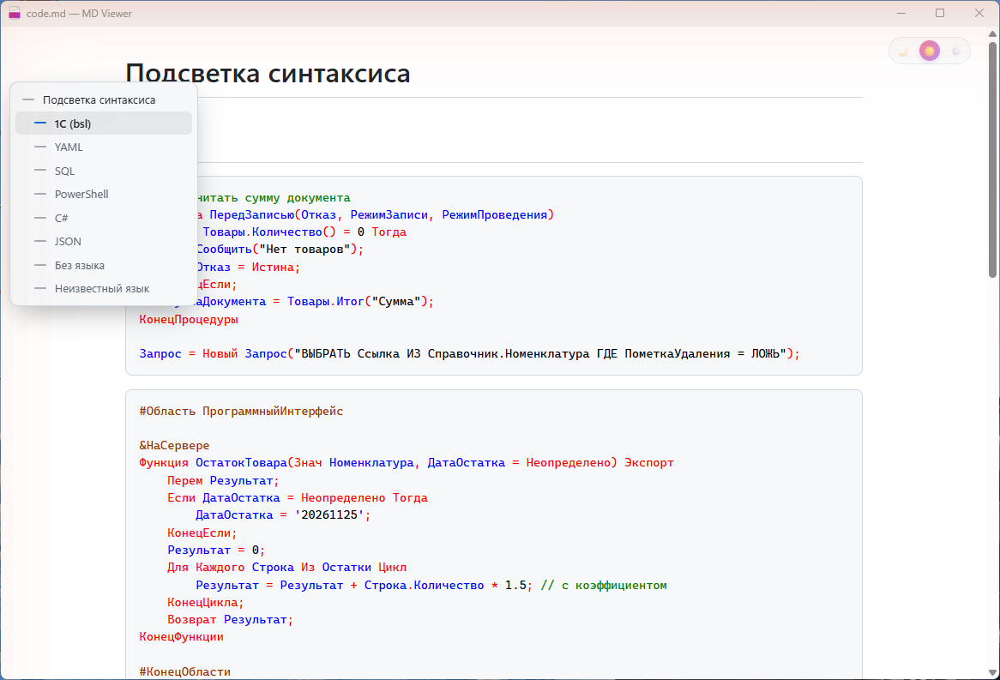

<p align="center">
  
</p>

<h1 align="center">MD Viewer</h1>

<p align="center">
<a href="https://t.me/top_1c"></a>
<a href="https://github.com/KotovDima1C/md-viewer/releases/latest"></a>
<a href="https://github.com/KotovDima1C/md-viewer/releases"></a>
<a href="https://github.com/KotovDima1C/md-viewer/blob/main/LICENSE"></a>
<a href="https://kotov.top"></a>
</p>

<p align="center">
  <b>Быстрый просмотрщик Markdown для Windows — с подсветкой кода 1С как в Конфигураторе.</b><br>
  Двойной клик по <code>.md</code> — и через долю секунды перед вами оформленный документ: код, таблицы, схемы.
</p>

<p align="center">
  <a href="https://github.com/KotovDima1C/md-viewer/releases/latest/download/md-viewer-win-x64.zip"><b>⬇ Скачать для Windows</b></a>
  &nbsp;·&nbsp;
  <a href="https://kotovdima1c.github.io/md-viewer/">Страница проекта</a>
</p>



## Код 1С — в привычных цветах

Документация, ТЗ, заметки к доработкам, ответы нейросетей — всё это сейчас в Markdown. Но код 1С в обычных просмотрщиках выглядит как серый текст. MD Viewer раскрашивает его так, как вы привыкли видеть в Конфигураторе:

- **ключевые слова и знаки** — красные: `Если`, `Тогда`, `Процедура`, `Возврат`, `=`, `;`, `(`;
- **имена** — синие: переменные, реквизиты, методы, `Сообщить`;
- **строки, числа и даты** — чёрные;
- **комментарии** — зелёные;
- **директивы и препроцессор** — коричневые: `&НаСервере`, `#Область`.

Достаточно указать язык у блока кода: ` ```bsl `, ` ```1c ` или ` ```1с `. В тёмной теме — та же схема, только приглушённая, чтобы не резала глаза:



Кроме 1С подсвечиваются ещё около 40 языков: SQL, YAML, JSON, XML, C#, Python, JavaScript, PowerShell, bat, bash и другие.

## Открывается мгновенно

Окно с готовым документом появляется за **0,3–0,5 секунды**. Никаких вкладок, проектов и хранилищ — открыл, прочитал, закрыл по `Esc`. Тяжёлые библиотеки (подсветка, схемы) подключаются только к тем файлам, где они нужны, поэтому простые заметки открываются так же быстро, как текстовый файл.

## Схемы Mermaid прямо в тексте

Блок-схемы, диаграммы последовательности, Ганта, круговые — пишутся текстом в блоке ` ```mermaid ` и рисуются сразу. Большие схемы раскрываются на всю ширину окна в натуральную величину; если не помещаются — прокрутка и перетаскивание мышью. Масштаб — панель при наведении (`−` `100%` `+` `↔`), `Ctrl+колесо` над схемой или двойной клик.



## И всё, что нужно для чтения



- **Оглавление слева** — полоски по заголовкам, текущий раздел подсвечивается при прокрутке; наведите — раскроется список.
- **Три темы** — 🌙 тёмная, ☀️ светлая, ⚙️ как в Windows. Выбор запоминается, заголовок окна перекрашивается вместе со страницей.
- **Автообновление** — сохранили файл в редакторе, страница обновилась сама, прокрутка на месте.
- **Широкие таблицы** раскрываются на всю ширину окна: колонки ограничены по ширине и сужаются до допустимого минимума, дальше — горизонтальная прокрутка.
- **Таблицы, списки задач, сноски, картинки** по относительным путям; служебный YAML-блок в начале файла скрыт.
- **Ссылки** на другие `.md` открываются в том же окне (`Alt+←` — назад), сайты — в браузере.
- **Безопасно**: скрипты из `.md` не выполняются.

## Установка

1. Скачайте архив `md-viewer-<версия>-win-x64.zip` со страницы [Releases](https://github.com/KotovDima1C/md-viewer/releases/latest) и распакуйте.
2. Запустите **`setup.cmd`**. Права администратора не нужны, .NET ставить не нужно — он внутри.
3. Если `.md` по-прежнему открываются другой программой: правый клик по `.md` → «Открыть с помощью» → «Выбрать другое приложение» → «Выбрать приложение на компьютере» → `%LOCALAPPDATA%\Programs\md-viewer\md-viewer.exe` → «Всегда».

Программа не подписана сертификатом: если Windows покажет «Система Windows защитила ваш компьютер» — «Подробнее» → «Выполнить в любом случае». Нужны Windows 10 или 11 с движком Edge WebView2 (в Windows 11 он уже есть). Обновление — тот же `setup.cmd` поверх, удаление — `uninstall.cmd`.

## Клавиши

| Клавиши | Действие |
|---|---|
| `Esc`, `Ctrl+W` | Закрыть |
| `Ctrl+F` | Поиск по тексту |
| `Ctrl+O` | Открыть другой файл (или перетащите файл в окно) |
| `Ctrl+E` | Открыть файл в Блокноте для правки |
| `Ctrl+колесо`, `Ctrl+=` / `Ctrl+-`, `Ctrl+0` | Масштаб страницы (над схемой — масштаб схемы) |
| `F5` | Перечитать |
| `Alt+←` / `Alt+→` | Назад / вперёд по ссылкам |
| `Ctrl+P` | Печать или PDF |

---

## Для разработчиков

**Стек:** C# / .NET 9, WinForms, WebView2, [Markdig](https://github.com/xoofx/markdig), [highlight.js](https://highlightjs.org/) 11.12.0 (BSD-3-Clause), [Mermaid](https://mermaid.js.org/) 11.17.2 (MIT).

Сборка и установка из исходников (нужен .NET SDK 9):

```powershell
powershell -ExecutionPolicy Bypass -File .\install.ps1
```

Архив релиза — `release.ps1` (самодостаточная сборка в `dist/`). К каждому релизу прикладываются два одинаковых архива: с версией в имени и `md-viewer-win-x64.zip` — на него ведёт постоянная ссылка `releases/latest/download/md-viewer-win-x64.zip`.

Страница проекта — `docs/index.html`, публикуется через GitHub Pages из папки `docs` ветки `main`.

| Где | Что |
|---|---|
| `src/MainForm.cs` | Окно, рендер Markdown, отдача файлов движку, навигация, автообновление, темы |
| `src/page.js` | Скрипт страницы: тема, подсветка и раскраска 1С, схемы и их масштаб, оглавление |
| `src/style.css` | Оформление страницы и цвета 1С |
| `src/vendor/` | highlight.js (ядро + 1c, powershell, dos, dockerfile), темы GitHub, mermaid — с лицензиями |
| `setup.ps1`, `install.ps1`, `uninstall.ps1` | Установка готовых файлов / сборка и установка / удаление; привязка `.md` у текущего пользователя |
| `tools/make_icon.py` | Генератор иконки (Pillow) |
| `samples/` | Файлы для проверки; `samples/local/` — для закрытых тестов, в git не попадает |

Настройки (окно, тема), кэш движка и журнал ошибок скриптов страницы (`errors.log`) — в `%LOCALAPPDATA%\md-viewer\`.

Скрипты из `.md` блокирует политика CSP: выполняются только встроенные скрипты программы, помеченные случайным ключом (nonce). Проверено на `<script>`, `onerror=` и ссылках `javascript:`.

## Лицензия

MD Viewer распространяется по лицензии [MIT](LICENSE): пользуйтесь, меняйте и распространяйте свободно, сохраняя упоминание автора.

Внутри используются highlight.js (BSD-3-Clause), Mermaid (MIT), Markdig (BSD-2-Clause), WebView2 SDK (BSD-3-Clause) и .NET (MIT) — их лицензии собраны в [THIRD-PARTY-NOTICES.txt](THIRD-PARTY-NOTICES.txt) и лежат рядом с программой после установки.
