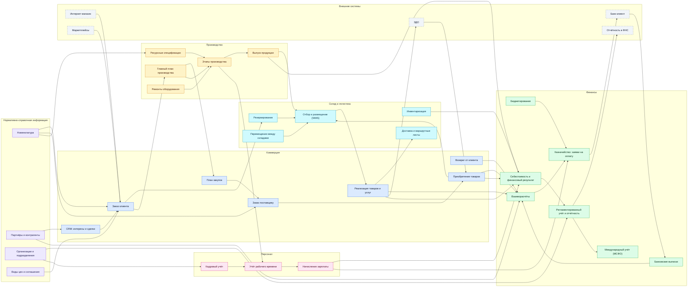

# Большая схема: подсистемы ERP и потоки данных между ними

Пример для проверки больших схем: типовая ERP-система — контуры, подсистемы внутри них и документы, которые передают данные из одной подсистемы в другую. Схема заметно шире колонки текста: она должна раскрыться на всю ширину окна, читаться в натуральную величину и прокручиваться.

Цвета задаёт сам файл через `classDef` — по контуру: коммерция, склад, производство, финансы, персонал, нормативно-справочная информация.

## Схема

## Обычный текст после схемы

Колонка текста остаётся прежней ширины — на всю ширину окна раскрывается только диаграмма. Наведите на неё: слева вверху появится панель масштаба (−, 100%, +, ↔), двойной клик переключает «натуральный размер» и «вписать по ширине», `Ctrl+колесо` над схемой меняет масштаб.
