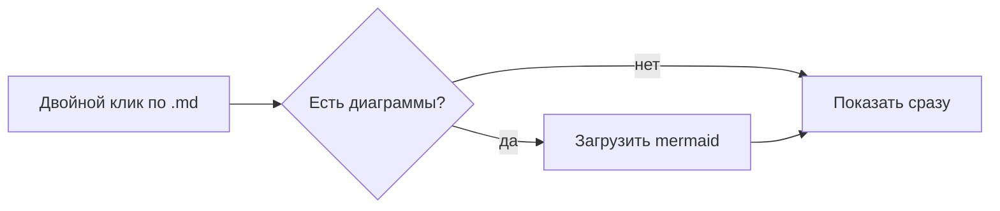
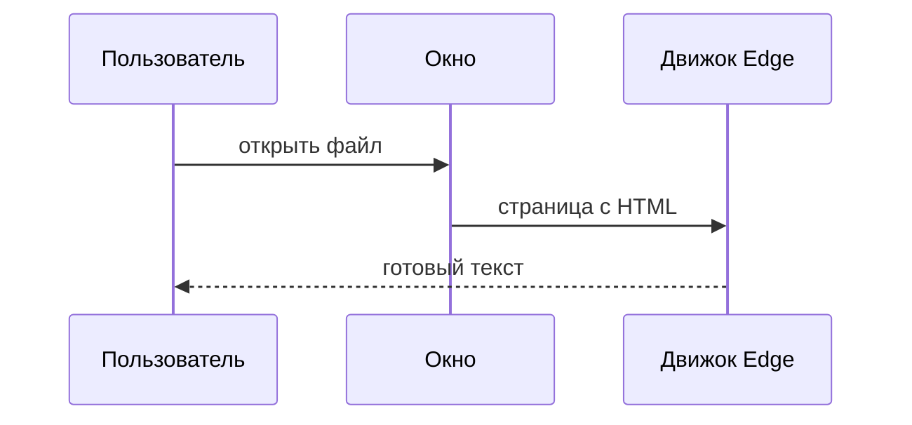
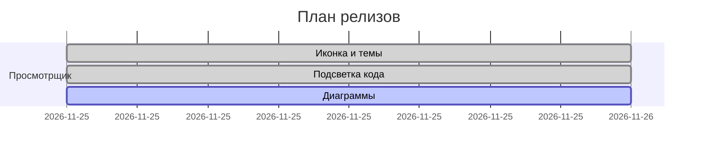
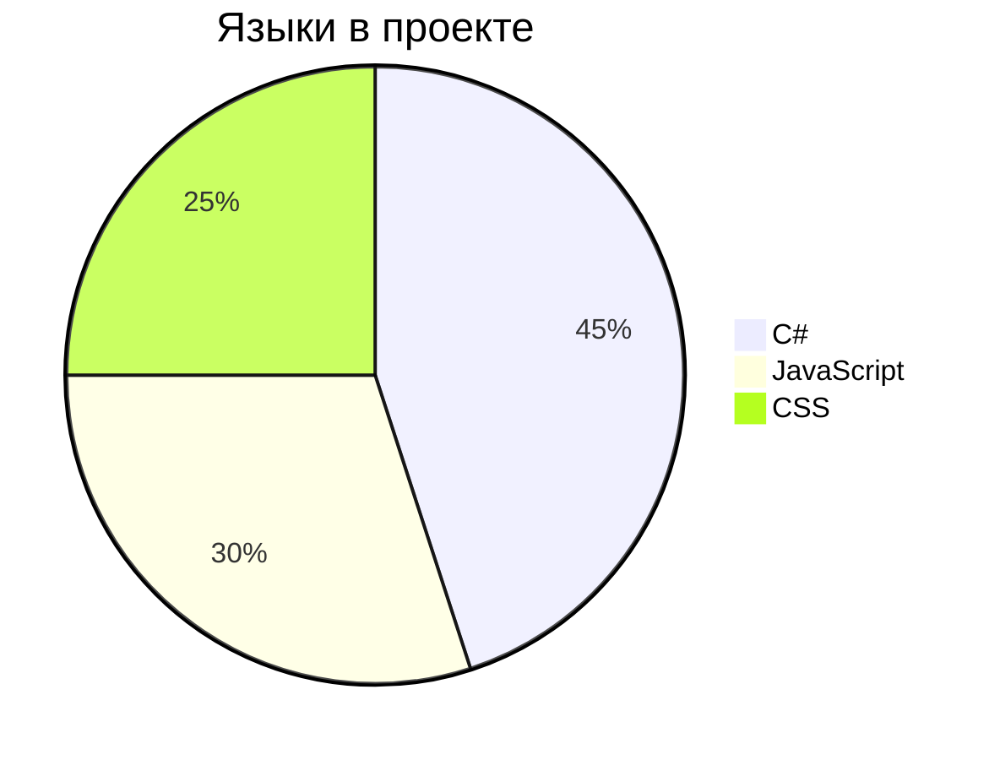

# Диаграммы Mermaid

## Блок-схема



## Последовательность



## Диаграмма Ганта



## Круговая



## Ошибка в диаграмме

```mermaid
flowchart LR
    A --> --> B
```

## Обычный код рядом

```bsl
Сообщить("Диаграммы не мешают подсветке");
```
