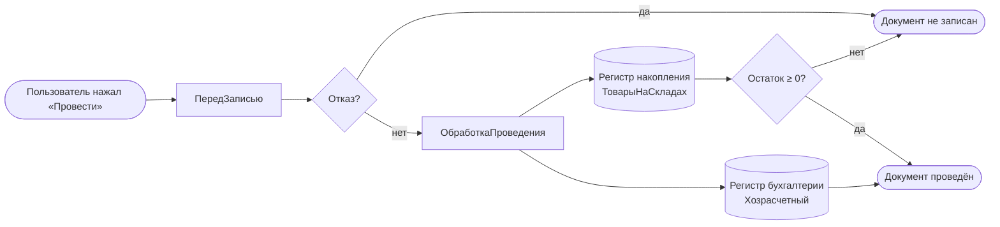
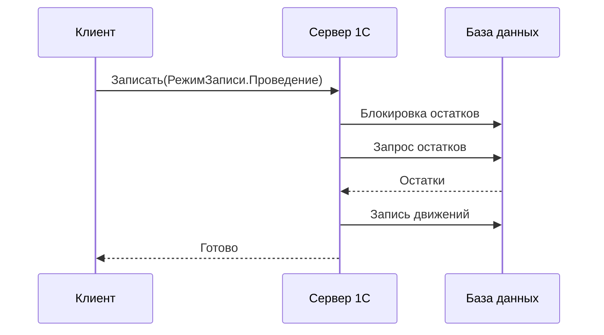

# Проведение документа: как это устроено

Схемы прямо в `.md` — блоком ` ```mermaid `. Ничего рисовать в отдельной программе не нужно: текст схемы лежит рядом с описанием и меняется вместе с ним.




